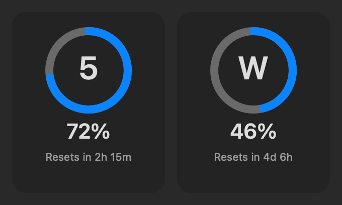
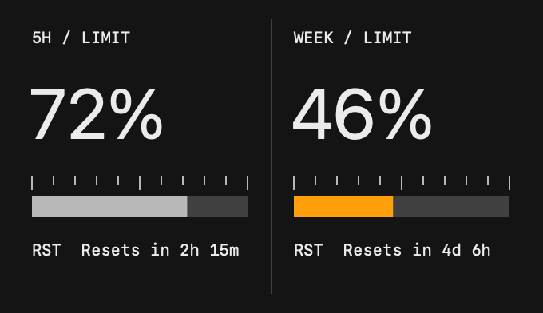
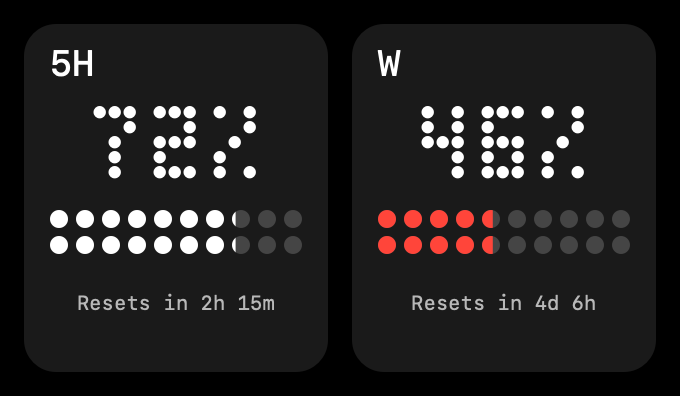
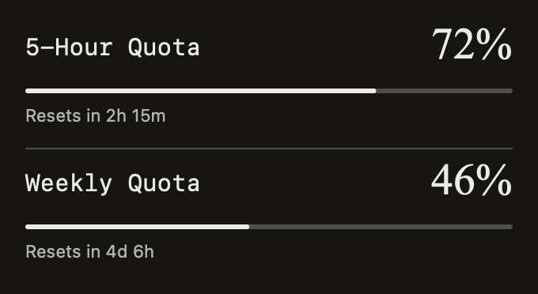
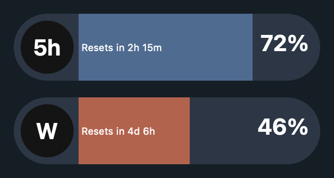
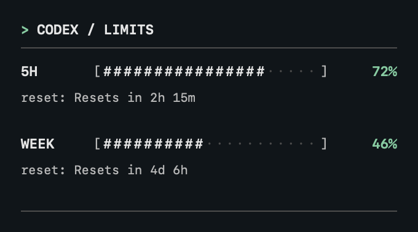

# Codex Bar

Codex Bar is a macOS menu bar app that shows your remaining Codex usage. The upper bar shows the five-hour limit and the lower bar shows the weekly limit; click them for percentages and reset times.

- Choose from six themes and Light, Dark, or Auto appearance.
- Keep a themed panel on your desktop or add a macOS widget.
- Enable optional low-quota and confirmed-reset notifications.
- Refresh automatically, after wake, or on demand. Previous values are dimmed when a refresh fails.

## Install

1. Install the Codex CLI and sign in to your ChatGPT account. Check with `codex login status` in Terminal. Installing the Codex app does not necessarily install the CLI.
2. Download the Apple Silicon archive from the [latest release](https://github.com/frankydzoro/codex-bar/releases/latest), unzip it, and move CodexBar.app to Applications.
3. Open Codex Bar. It appears in the menu bar, not the Dock.

The app requires macOS 13 or later. The desktop widget requires macOS 14 or later. The release is locally signed and not notarized by Apple, so macOS may show a security warning. Use Privacy & Security settings to open an app you trust.

## Use

Click the menu bar indicator to open the panel. Right-click it (or click with two fingers on a trackpad) for Refresh, Picture-in-Picture, Settings, Check for Updates, and Quit. Settings contains the appearance and notification options. Notifications are off by default; the warning threshold defaults to 20% and also controls indicator colors.

**Picture-in-Picture** opens a movable desktop window in the selected theme. It stays open while the app is running and can be covered by other windows. Its position and visibility are restored on the next launch.

To add the **widget** on macOS 14 or later, right-click the desktop, choose Edit Widgets, and add the medium Codex Bar widget. It uses a horizontal layout in the selected theme. Keep the app running for fresh data; macOS controls widget refresh timing, so values may lag behind the app.

Updates are checked manually from the context menu. Version 1.4.2 and older need one manual upgrade before they can use the updater. See [how Codex Bar works](docs/DETAILS.md) for refresh, notification, widget, and data details.

## Themes

Choose a theme in **Settings → Appearance**. These examples use Dark mode and illustrative values.

<table>
  <tr>
    <td align="center"><strong>Classic</strong><br></td>
    <td align="center"><strong>Industrial</strong><br></td>
  </tr>
  <tr>
    <td align="center"><strong>Dot Matrix</strong><br></td>
    <td align="center"><strong>Paper</strong><br></td>
  </tr>
  <tr>
    <td align="center"><strong>Capsules</strong><br></td>
    <td align="center"><strong>Terminal</strong><br></td>
  </tr>
</table>

## Troubleshooting

- **Codex CLI not found:** GUI apps may have a shorter PATH than Terminal. Install the CLI in a standard location.
- **Login or network error:** run `codex login status`, sign in if needed, check your connection, and choose Refresh.
- **Previous data shown:** the last refresh failed. The panel shows the error and age of the last successful update.
- **Limit unavailable:** Codex may not have returned that window; reset times appear only when provided.

## Build and test

Building from source requires Xcode Command Line Tools and an internet connection for the first build to download Sparkle. From the repository folder:

```sh
./build.sh
open build/CodexBar.app
./Tests/run.sh
```

The build is locally signed and not notarized. See [publishing updates](docs/RELEASING.md) for release instructions.

## License

[MIT License](LICENSE) · [Español](docs/LICENSE.es-419.md) · [Русский](docs/LICENSE.ru.md)
