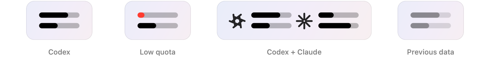
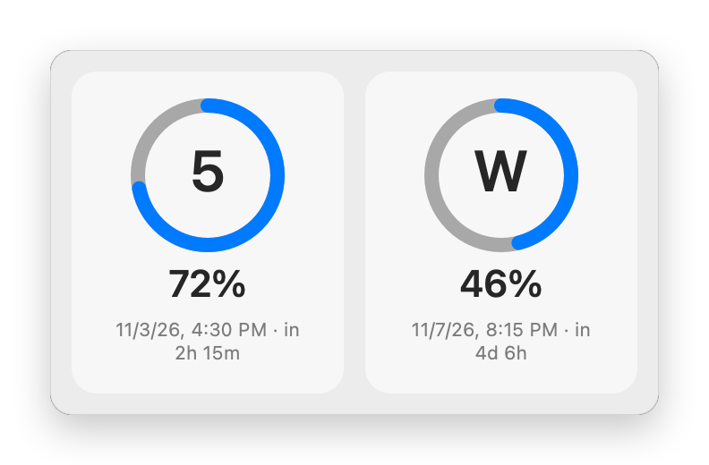
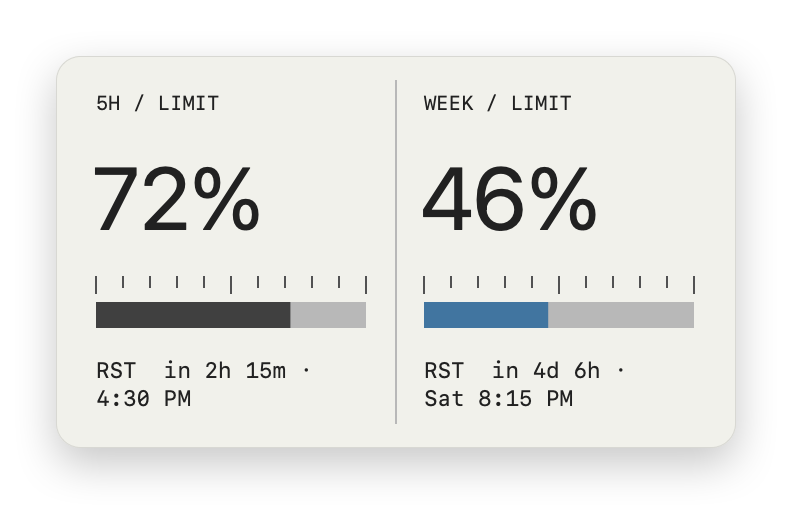
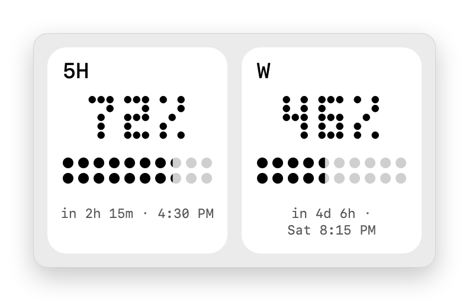
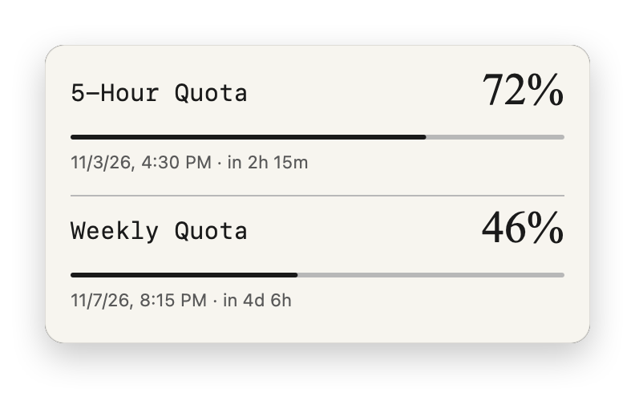
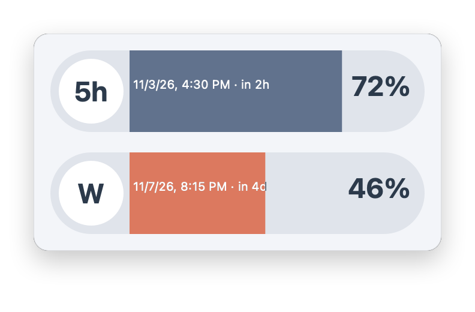
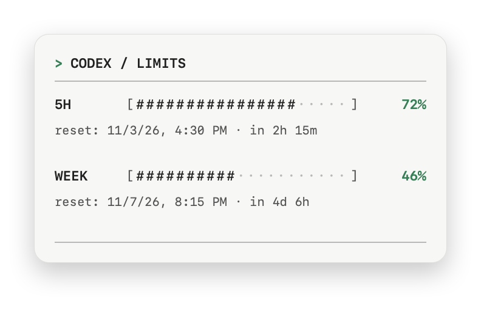

# Limitwick

https://github.com/user-attachments/assets/7dcc1168-e311-40b4-9aa4-406b0f773566

Limitwick is a small macOS menu bar app that shows how much of your **Codex** and **Claude Code** subscription usage is left. It tracks the five-hour and weekly limits, shows when each one resets, and can show when Codex or Claude Code is working right now.

- Track Codex, Claude, or both side by side.
- Two bars in the menu bar: five-hour limit on top, weekly limit below.
- Click for a panel with percentages, reset times, and time remaining, in one of six themes.
- Optional activity animation while Codex or Claude Code is working or using a tool.
- Optional notifications for low quota and confirmed resets.
- Picture-in-Picture window and a macOS desktop widget.
- Automatic refresh, refresh after wake, and built-in updates.

## Contents

- [Requirements](#requirements)
- [Install](#install)
- [Using Limitwick](#using-limitwick)
- [Settings](#settings)
- [Activity indicator](#activity-indicator)
- [Notifications](#notifications)
- [Picture-in-Picture and widget](#picture-in-picture-and-widget)
- [Themes](#themes)
- [Refresh and updates](#refresh-and-updates)
- [Privacy](#privacy)
- [Troubleshooting](#troubleshooting)
- [Build and test](#build-and-test)

## Requirements

- A Mac with Apple Silicon and macOS 13 or later. The desktop widget requires macOS 14 or later.
- For Codex: the **Codex CLI**, signed in to your ChatGPT account. Installing the Codex or ChatGPT app does not necessarily install the CLI. Check with `codex login status` in Terminal.
- For Claude: **Claude Code** ([setup guide](https://code.claude.com/docs/en/setup)), signed in to your Claude subscription. Run `claude` in Terminal once to sign in. The Claude desktop app does not necessarily install the CLI.

You need only the tool for the service you want to track.

## Install

1. Download the Apple Silicon archive from the [latest release](https://github.com/frankydzoro/codex-bar/releases/latest).
2. Unzip it and move **Limitwick.app** to the Applications folder.
3. Open Limitwick. It appears in the menu bar, not in the Dock.
4. Codex is shown by default. To track Claude or both, right-click the menu bar icon, choose **Settings…**, and set **Show limits** to **Claude** or **Both**.

The app is locally signed and not notarized by Apple, so macOS may block the first launch. Open **System Settings → Privacy & Security** and allow Limitwick there.

### Install with Codex

You can ask Codex to install the app for you. Paste this prompt into Codex:

```text
Install Limitwick from https://github.com/frankydzoro/codex-bar. Check that my Mac meets the requirements and that Codex CLI is installed and signed in. Download the Apple Silicon archive from the latest GitHub release, install Limitwick.app in Applications, open it, and verify that it launched. If a step needs my input or macOS blocks the app, explain what I need to do.
```

## Using Limitwick

### Menu bar indicator

<picture>
  <source media="(prefers-color-scheme: dark)" srcset="docs/images/menubar-dark.png">
  
</picture>

Each service is shown as a pair of bars:

- **Top bar:** remaining five-hour limit.
- **Bottom bar:** remaining weekly limit.

When **Both** is selected, Codex and Claude each get their own pair of bars with a small logo in front. A bar turns red when the remaining quota drops below the warning threshold (20% by default). If the last refresh failed, the bars are dimmed and keep the previous values. Hover over the icon for a tooltip.

### Panel

**Click** the menu bar icon to open the panel. For each service it shows:

- remaining five-hour and weekly quota as a percentage;
- when each limit resets, as a local date and time and as time remaining;
- other limit windows, if the service reports any;
- an error message and the age of the data if the last refresh failed.

Click outside the panel or switch to another app to close it.

### Menu

**Right-click** the menu bar icon (or click with two fingers on a trackpad) to open the menu:

| Item | What it does |
|---|---|
| **Refresh** (⌘R) | Fetches fresh usage data now. |
| **Show / Hide Picture-in-Picture** | Opens or closes a movable window with the panel. |
| **Settings…** (⌘,) | Opens Settings. |
| **About Limitwick** | Shows the version and a link to GitHub. |
| **Check for Updates…** | Checks for a new version. When one is available, this item shows its version number. |
| **Quit** (⌘Q) | Quits the app. |

## Settings

Open **Settings…** from the menu. The window has four sections.

### AI services

**Show limits** chooses what to track: **Codex**, **Claude**, or **Both**.

### Provider settings

**Configure** chooses which service the settings below apply to: **Codex** or **Claude**. Theme, appearance, activity, and notifications are set separately for each service. Change the selection to edit the other service.

### Appearance

- **Theme:** the look of the panel, menu, Picture-in-Picture window, and widget. See [Themes](#themes).
- **Mode:** **Light**, **Dark**, or **Auto**. Auto follows the macOS appearance.
- **Show … activity in menu bar:** shows an animation next to the bars while the selected service is working. See [Activity indicator](#activity-indicator).

When **Both** is selected, each service's block in the panel uses that service's own theme and mode.

### Notifications

- **Low remaining quota:** notifies you when a limit drops below the threshold.
- **Confirmed quota reset:** notifies you when a limit has reset.
- **Low threshold:** from 1% to 99%, 20% by default. It also sets when the bars and rings turn red, even if notifications are off.
- **Notification Settings…:** opens macOS notification settings if alerts are blocked.

See [Notifications](#notifications) for details.

## Activity indicator

Limitwick can show a small animation to the left of a service's bars:

| Animation | Meaning |
|---|---|
| Spinner | The service is working on a request. |
| Terminal | The service is running a tool, such as a shell command. |
| Checkmark (briefly) | Work has finished. |

The indicator takes up space in the menu bar only while it is active. With **Reduce motion** turned on in macOS accessibility settings, a still image is shown instead of an animation.

The indicator uses *hooks*: small scripts that Codex or Claude Code runs on each event and that pass the event to Limitwick. They forward only the event type, session and tool-call IDs, and the time. Prompts, responses, commands, and tool output are never forwarded.

### Claude Code

1. In **Settings**, set **Configure** to **Claude**.
2. Turn on **Show Claude activity in menu bar**. If the hooks are not installed yet, Limitwick installs them and confirms. You can also use the **Install Claude hooks** button.
3. Start a new Claude Code session. Claude Code reads hooks only when a session starts. To include a session that is already open, type `/exit` in it, then run `claude --continue` to resume the same conversation.

The text below the checkbox shows the current status:

- *hooks are not installed:* click **Install Claude hooks**;
- *Waiting for activity:* the hooks are installed, but no events have arrived yet; start a new Claude Code session and send a request;
- *Receiving activity from Claude Code:* everything works.

To uninstall, click **Remove Claude hooks**. Only Limitwick's own entries are added to or removed from `~/.claude/settings.json` (or `$CLAUDE_CONFIG_DIR/settings.json`). Your other settings and hooks are kept. The hook script is stored in `~/Library/Application Support/CodexBar/`, so the hooks keep working after the app is moved or updated. Turning off the checkbox hides the indicator but leaves the hooks installed.

### Codex

The Codex activity checkbox is on by default, but Codex hooks are installed with a Terminal command. Run it after installing the app in Applications:

```sh
/usr/bin/python3 '/Applications/Limitwick.app/Contents/Resources/useAnimations/activity-setup.py' install
```

Next, review and trust the new hooks in **Codex Settings → Hooks** or with `/hooks` in the Codex CLI, then restart Codex sessions. Codex does not run hooks that have not been trusted. To remove them, run the same command with `remove` instead of `install`. If you move the app, run the command again from the new location.

See [how Limitwick works](docs/DETAILS.md) for the limits of activity detection.

## Notifications

Both notification types are off by default. When you turn one on, macOS asks for permission to show alerts.

- **Low remaining quota** is sent once per limit and reset period, when the remaining quota first drops below the threshold.
- **Confirmed quota reset** is sent after a refresh confirms that a new period has started, so it can arrive a few minutes after the actual reset.

Notifications are sent only after a successful refresh. Limitwick cannot reliably detect a switch to another account, so alerts may be missed or refer to the previous account after you switch.

## Picture-in-Picture and widget

**Picture-in-Picture** is a separate window with the panel, in the selected theme. Open it from the menu and drag it wherever you like. It stays open while the app runs, can be covered by other windows, and reopens in the same place the next time the app launches.

To add the **desktop widget** (macOS 14 or later):

1. Right-click the desktop and choose **Edit Widgets**.
2. Find **Limitwick** and add the medium widget.

The widget shows the same panel in a horizontal layout. It gets data from the running app, so keep Limitwick open. macOS decides when to refresh widgets, so the widget can lag behind the app.

## Themes

Choose a theme in **Settings → Appearance → Theme**. The images follow your GitHub light or dark mode and use illustrative values.

<table>
  <tr>
    <td align="center"><strong>Classic</strong><br>
      <picture>
        <source media="(prefers-color-scheme: dark)" srcset="docs/images/theme-classic-dark.png">
        
      </picture>
    </td>
    <td align="center"><strong>Industrial</strong><br>
      <picture>
        <source media="(prefers-color-scheme: dark)" srcset="docs/images/theme-industrial-dark.png">
        
      </picture>
    </td>
  </tr>
  <tr>
    <td align="center"><strong>Dot Matrix</strong><br>
      <picture>
        <source media="(prefers-color-scheme: dark)" srcset="docs/images/theme-dots-dark.png">
        
      </picture>
    </td>
    <td align="center"><strong>Paper</strong><br>
      <picture>
        <source media="(prefers-color-scheme: dark)" srcset="docs/images/theme-paper-dark.png">
        
      </picture>
    </td>
  </tr>
  <tr>
    <td align="center"><strong>Capsules</strong><br>
      <picture>
        <source media="(prefers-color-scheme: dark)" srcset="docs/images/theme-capsules-dark.png">
        
      </picture>
    </td>
    <td align="center"><strong>Terminal</strong><br>
      <picture>
        <source media="(prefers-color-scheme: dark)" srcset="docs/images/theme-terminal-dark.png">
        
      </picture>
    </td>
  </tr>
</table>

## Refresh and updates

- Usage refreshes automatically every three minutes, after your Mac wakes from sleep, and when you choose **Refresh**.
- After repeated errors, the interval grows up to 24 minutes and returns to normal after a successful refresh.
- Codex usage also updates as soon as Codex reports a new rate-limit event.

Limitwick checks for new versions quietly at launch and once a day. When an update is available, the menu highlights it, and a red dot appears on the menu bar icon for a new major version. Choose the menu item to see what changed and install the update. Version 1.4.2 and older need a one-time manual upgrade before the built-in updater works.

## Privacy

- Limitwick does not ask for your password and does not store credentials. It uses the sign-in of your existing Codex CLI and Claude Code.
- Codex usage comes from a local `codex app-server`. Claude usage comes from running `/usage` in Claude Code in a hidden terminal. While doing so, Claude Code runs with hooks and MCP servers turned off and with no tools allowed.
- The app has no server of its own. Codex and Claude Code contact their own services, and update checks contact GitHub.
- The widget snapshot contains the panel image and the quota values, but no credentials or account IDs.

## Troubleshooting

| Problem | What to do |
|---|---|
| **Codex CLI not found** | Apps opened from Finder can have a shorter PATH than Terminal. Install the Codex CLI in a standard location, such as through npm or Homebrew. |
| **Codex login or network error** | Run `codex login status`, sign in if needed, check your connection, and choose **Refresh**. |
| **Claude Code not found or not signed in** | Install Claude Code, run `claude` in Terminal, sign in, and choose **Refresh**. |
| **Claude usage unavailable** | Run `/usage` in Claude Code to check the account and connection. Limitwick reads Claude Code's on-screen output, which can change when Claude Code updates. Reset times that cannot be read are shown as unavailable. |
| **Bars are dimmed** | The last refresh failed, so the previous values are shown. The panel shows the error and how old the data is. |
| **A limit is missing** | The service did not report that limit. Reset times appear only when the service provides them. |
| **No activity animation for Claude** | Check the status text in **Settings → Configure: Claude**. Install the hooks if needed and start a new Claude Code session. |
| **No activity animation for Codex** | Make sure the hooks are installed and trusted in Codex, and that the session was started after they were trusted. |
| **No notifications** | Turn on the notification type in Settings and allow alerts in **Notification Settings…**. |
| **macOS blocks the app** | Allow it in **System Settings → Privacy & Security**. The app is not notarized by Apple. |

## Build and test

Building from source requires Xcode Command Line Tools. The first build needs an internet connection to download Sparkle and Lottie. From the repository folder:

```sh
./build.sh
open build/Limitwick-Development.app
./Tests/run.sh
```

README images are rendered from the theme and menu bar code with fixed demo values. Regenerate them after a design change with `./scripts/render-screenshots.sh`; it writes `docs/images` and compresses the files with `oxipng` if it is installed.

The default build is `build/Limitwick-Development.app`. It uses its own identifiers and widget storage, so it does not interfere with the installed app. It is locally signed and not notarized. See [publishing updates](docs/RELEASING.md) for release instructions and [how Limitwick works](docs/DETAILS.md) for technical details.

## License

[MIT License](LICENSE) · [Español](docs/LICENSE.es-419.md) · [Русский](docs/LICENSE.ru.md)
