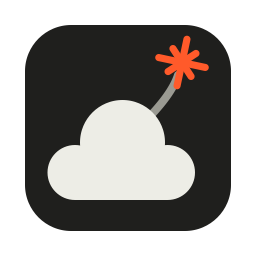
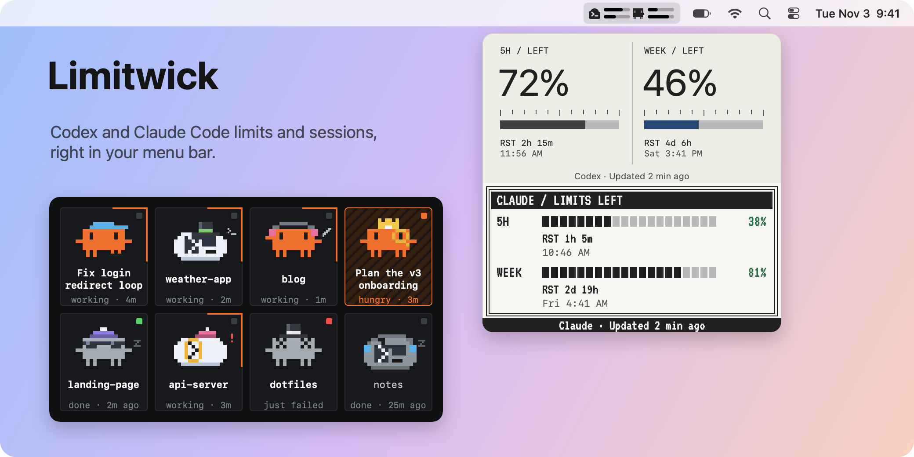
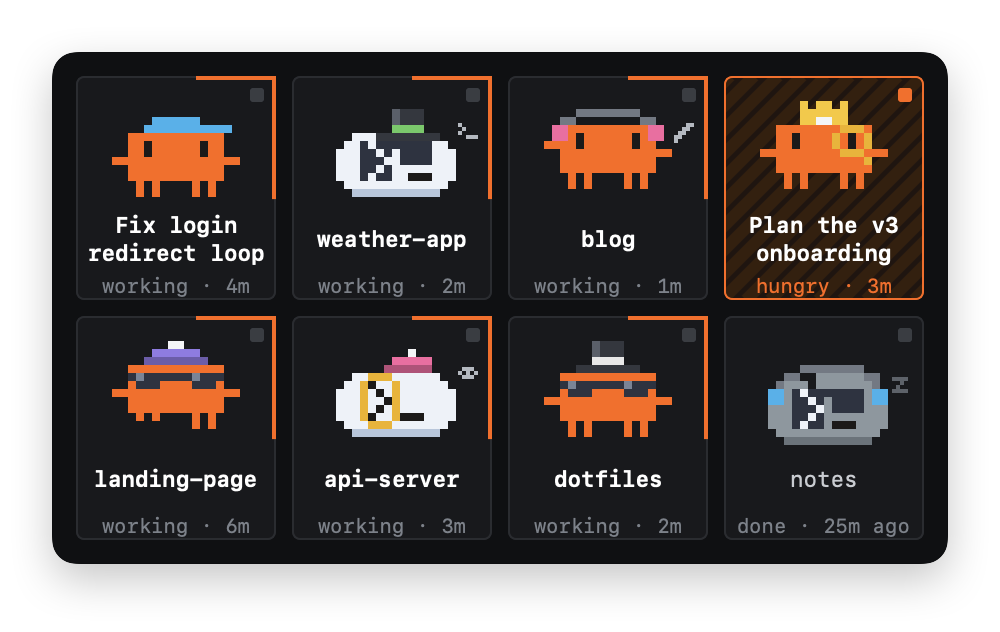
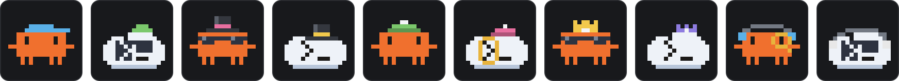
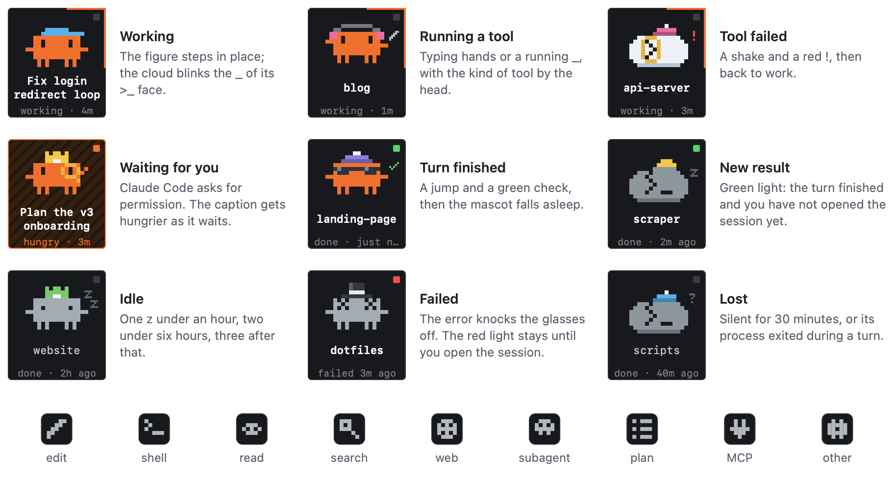
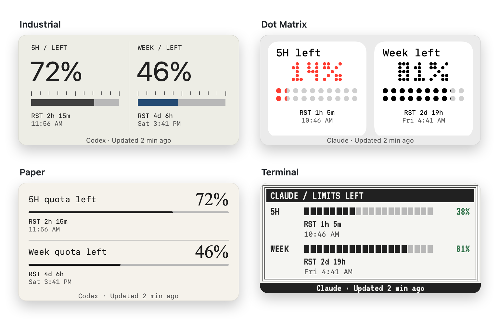
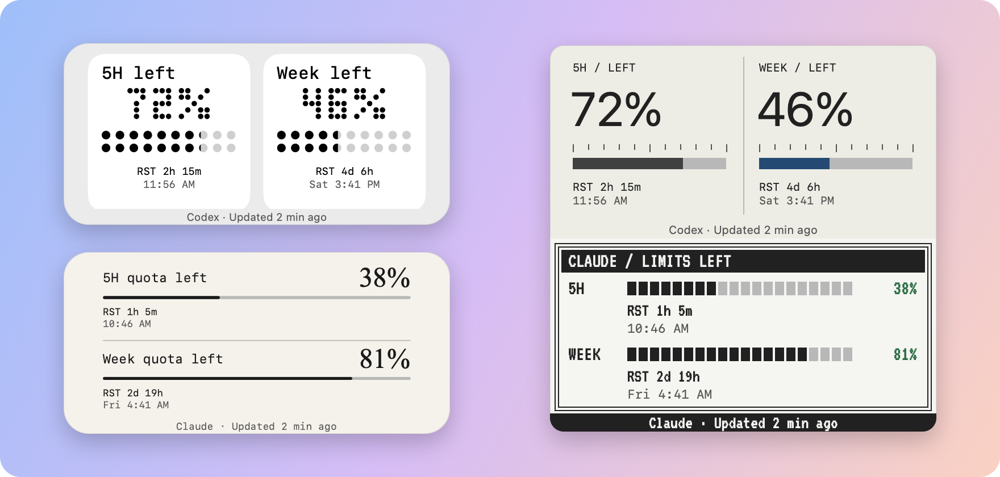
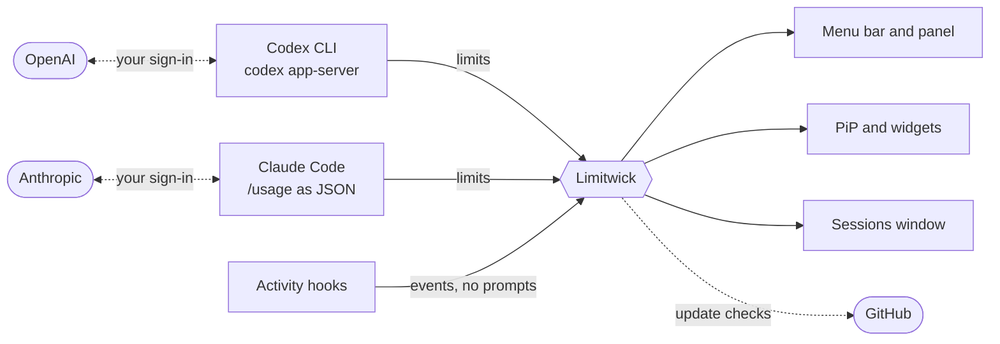

<p align="center">
  
</p>

<h1 align="center">Limitwick</h1>

<p align="center">
  <b>A small macOS menu bar app that shows how much of your Codex and Claude Code usage is left<br>and what your coding agents are doing right now.</b>
</p>

<p align="center">
  <a href="https://github.com/Peter-Grishechkin/Limitwick/releases/latest"></a>
  
  
  <a href="https://github.com/Peter-Grishechkin/Limitwick/releases"></a>
  <a href="LICENSE"></a>
  <a href="https://t.me/seo_and_sem"></a>
</p>

<picture>
  <source media="(prefers-color-scheme: dark)" srcset="docs/images/hero-dark.png">
  
</picture>

https://github.com/user-attachments/assets/46214406-0869-4078-9463-29192c8ed6ae


- **Limits at a glance.** Two bars per service in the menu bar: the five-hour limit on top, the weekly one below. Click for percentages and reset times.
- **Sessions.** Your Codex and Claude Code sessions of the last 24 hours as pixel mascots that work, wait for you, finish and fail. Click one to open it.
- **Activity.** An animation next to the bars while Codex or Claude Code is working or running a tool.
- **Four themes** in light and dark, a Picture-in-Picture window and 16 desktop widgets.
- **Alerts** for low quota and confirmed resets, both optional.
- **No account of its own.** Limitwick uses the sign-in of your Codex CLI and Claude Code and has no server.

All images in this README are rendered from the app's own views with demo data. Every setting, the files Limitwick keeps, how to uninstall it and how the code is organised are in the [wiki](https://github.com/Peter-Grishechkin/Limitwick/wiki).

## Install

You need a Mac with Apple Silicon and macOS 13 or later (widgets need macOS 14), plus the command-line tool for each service you want to track:

- **Codex:** the Codex CLI, signed in to your ChatGPT account. Check with `codex login status`. The Codex and ChatGPT apps do not necessarily install it.
- **Claude:** [Claude Code](https://code.claude.com/docs/en/setup), signed in to your Claude subscription. Run `claude` in Terminal once to sign in. The Claude desktop app does not necessarily install it.

Then:

1. Download the archive from the [latest release](https://github.com/Peter-Grishechkin/Limitwick/releases/latest), unzip it and move **Limitwick.app** to Applications.
2. Open it. Limitwick lives in the menu bar, not in the Dock.
3. Codex is shown by default. To track Claude or both, right-click the menu bar icon, choose **Settings…** and set **Show limits**.

The app is signed locally and not notarized by Apple, so macOS may block the first launch: allow it in **System Settings → Privacy & Security**.

<details>
<summary><b>Install with an agent:</b> let Claude Code or Codex do it for you</summary>

<br>

A coding agent with Terminal access can check the requirements, install the app, choose what to track and turn on the activity indicator. You only finish sign-in in the browser and, for Codex, trust the new hooks.

**1. Let the agent run commands without stopping.** The setup writes to `/Applications`, `~/.claude`, `~/.codex` and the app's preferences, so an agent in its default mode asks before almost every step:

| Agent | Command | What it allows |
| --- | --- | --- |
| Claude Code | `claude --permission-mode auto` | Runs commands and edits on its own; still stops before risky actions. |
| Codex CLI | `codex --sandbox danger-full-access --ask-for-approval never` | Full access to your files and network with no prompts. Use it for this task, then start Codex normally again. |

In the Claude desktop app or the Codex app, choose the same level in the session's permission menu.

**2. Paste this prompt.** Change `Both` on the first line to `Codex` or `Claude` if you track only one service.

```text
Track: Both

Install and set up Limitwick (https://github.com/Peter-Grishechkin/Limitwick) on this Mac. Work on your own and stop only for steps that need me.

1. Check that the Mac is Apple Silicon (`uname -m` prints arm64) and runs macOS 13 or later. If not, stop and tell me.
2. For each service in "Track" make sure its CLI is installed and signed in:
   - Codex: `codex login status`. If the CLI is missing, install it with the official method from OpenAI's Codex docs. If it is not signed in, run `codex login` and tell me to finish sign-in in the browser.
   - Claude: `claude auth status`. If Claude Code is missing, install it with the official installer from https://code.claude.com/docs/en/setup. If it is not signed in, tell me to run `claude` in Terminal and sign in, then wait for me.
3. Find the latest release with the GitHub API or `gh release view -R Peter-Grishechkin/Limitwick`, and download the `*-macOS-Apple-Silicon.zip` asset with curl or gh into a temporary folder. Unzip it and check that Limitwick.app is inside.
4. If Limitwick is running, quit it (`osascript -e 'quit app "Limitwick"'`). Move an existing /Applications/Limitwick.app to the Trash and copy the new one there. Leave copies with other names, such as CodexBar.app: Limitwick removes version 1.x itself on first launch.
5. Set what to track: `defaults write local.limitwick.app providers -string <codex|claude|both>`, matching "Track".
6. Install the activity hooks for the tracked services:
   - Claude: `/usr/bin/python3 /Applications/Limitwick.app/Contents/Resources/useAnimations/claude-activity-setup.py install`
   - Codex: `/usr/bin/python3 /Applications/Limitwick.app/Contents/Resources/useAnimations/activity-setup.py install`
   These scripts add only Limitwick's own entries and keep my other settings and hooks.
7. Open the app with `open /Applications/Limitwick.app` and check with `pgrep -x Limitwick` that it is running. If macOS blocks it, tell me to allow it in System Settings → Privacy & Security, then check again.
8. Finish with a short report: what you installed or changed, the installed version, and what is left for me. If Codex hooks were installed, remind me to trust them in Codex Settings → Hooks or with /hooks in the Codex CLI, and to restart open Codex and Claude Code sessions.

Never ask me for passwords or tokens and do not print them. Do not change other apps, settings or hooks. Delete only the temporary files you created.
```

</details>

<details>
<summary><b>Updating from version 1.x</b> (CodexBar)</summary>

<br>

Version 2.0 uses new app identifiers, so it installs as a new app; version 1.x shows the update notice and opens the release page. On first launch Limitwick quits every 1.x copy (including **CodexBar.app**), moves it to the Trash, copies your settings over and switches installed Claude and Codex hooks to the new app. If Codex hooks were switched, trust them again in **Codex Settings → Hooks**. Remove the old widgets and add new ones from the gallery; macOS asks again for permission to send notifications.

</details>

## Menu bar and panel

<picture>
  <source media="(prefers-color-scheme: dark)" srcset="docs/images/menubar-dark.png">
  
</picture>

Each service is a pair of bars: the five-hour limit on top, the weekly limit below. With **Both** selected, Codex and Claude each get a pair with a small logo. A bar turns red below the warning threshold (20% by default). After a failed refresh the bars dim and keep the previous values.

**Click** the icon for the panel: the percentage left, the time to each reset ("RST 3d 4h") with the local reset time under it, and a footer with the age of the data. If the last refresh failed, the card dims, the footer says "Previous data" and the error appears under the card.

**Right-click** for the menu: **Refresh** (⌘R), **Show Picture-in-Picture**, **Show Sessions**, **Settings…** (⌘,), **About Limitwick**, **Check for Updates…** and **Quit** (⌘Q).

## Sessions



**Show Sessions** opens a window with your Codex and Claude Code sessions of the last 24 hours, one tile each: a little orange figure for Claude, a cloud with a `>_` face for Codex. Sessions of the Claude app show their title from the app; others show the project folder.



Every mascot wears a hat, and about two in three also wear sunglasses or a monocle. The outfit and its colour come from the session, stay the same after a restart and tell apart sessions in the same folder.

<picture>
  <source media="(prefers-color-scheme: dark)" srcset="docs/images/session-states-dark.png">
  
</picture>

- **Click a tile** to open the session: a Claude app session opens in the app, a terminal session brings its terminal to the front. Opening a session, a new prompt in it or **Mark All as Seen** (right-click the window) turns its green or red light off. A Claude app session also counts as opened when you switch to it in the Claude app after the turn ends: the light goes off within 15 seconds. If you were already in that session when the turn ended, the light still comes on. For terminal sessions the window cannot tell whether you already read the answer.
- **Drag** the window by the space between tiles. In **Settings → Sessions window** choose **Above all windows** or **On the desktop**, and 4, 8 or 16 tiles.
- **Reduce motion** in macOS Accessibility settings keeps every tile in one still pose. Tiles also stop while other windows cover the whole window.
- Live states come from the [activity hooks](#activity-indicator). Earlier sessions are read from local Claude and Codex session files when the window opens and every five minutes. Codex hooks do not report permission prompts, so only Claude tiles wait for you.

## Activity indicator

| Animation | Meaning |
| --- | --- |
| Spinner | The service is working on a request. |
| Terminal | The service is running a tool, such as a shell command. |
| Checkmark (briefly) | Work has finished. |

The animation appears to the left of the service's bars and takes space only while active; with **Reduce motion** it is a still image. The indicator and the Sessions window use *hooks*: small scripts that Codex or Claude Code runs on each event to pass it to Limitwick.

1. In **Settings**, select the service (with **Both**, use **Settings for**) and turn on **Show … activity in menu bar**. This installs the hooks.
2. **Codex only:** trust the new hooks in **Codex Settings → Hooks** or with `/hooks` in the Codex CLI. Codex does not run untrusted hooks.
3. Start a new session. Claude Code reads hooks only at session start; to include an open one, type `/exit` and run `claude --continue`.

The text under the checkbox shows whether hooks are installed and whether events arrive. **Remove … hooks** takes out only Limitwick's own entries. What the hooks send, and how to install them from Terminal, is in [how Limitwick works](docs/DETAILS.md#codex-activity-indicator).

## Themes

<picture>
  <source media="(prefers-color-scheme: dark)" srcset="docs/images/themes-dark.png">
  
</picture>

Choose a theme and **Light**, **Dark** or **Auto** in **Settings → Appearance**, separately for each service. The panel, the Picture-in-Picture window and the widgets show the same card. Red is used only for the low-quota warning. Terminal is set in [VT323](https://fonts.google.com/specimen/VT323) (SIL Open Font License).

## Picture-in-Picture and widgets

<picture>
  <source media="(prefers-color-scheme: dark)" srcset="docs/images/widgets-dark.png">
  
</picture>

**Picture-in-Picture** is a movable window with the panel's cards. It reopens in the same place the next time the app launches.

**Widgets** (macOS 14 or later): right-click the desktop, choose **Edit Widgets**, find **Limitwick** and pick a medium widget by theme, service and Light or Dark appearance. Each variant keeps its look and gets limits even when its service is hidden from the menu bar. Keep Limitwick running for fresh data; macOS decides when widgets redraw.

## Settings

| Section | What you set |
| --- | --- |
| **AI services** | **Show limits:** Codex, Claude or Both. **Install Claude Code…** or **Sign in to Claude…** when needed. With Both, **Settings for** picks the service the sections below apply to. |
| **Appearance** | Theme, mode and the activity animation in the menu bar. |
| **Sessions window** | Position and the number of tiles. |
| **Low quota** | **Warn below**, 1–99%, 20% by default. Below it the bars and cards turn red, even with notifications off. |
| **Notifications** | **Low remaining quota**, **Confirmed quota reset** and a link to macOS notification settings. |

## Refresh, notifications and updates

- Usage refreshes every three minutes, after your Mac wakes and when you choose **Refresh**. After repeated errors the interval grows to 24 minutes. Codex usage also updates when Codex reports a new rate-limit event.
- Both notifications are off by default. A low-quota alert comes once per limit and period; a reset alert comes after a refresh confirms the new period, so it can be a few minutes late. Limitwick cannot detect a switch to another account, so alerts may refer to the previous one.
- Limitwick checks for new versions at launch and once a day. The menu highlights an update, and a red dot on the icon marks a new major version. Version 1.4.2 and older need a one-time manual upgrade.

## Privacy



- Limitwick does not ask for passwords and stores no credentials. It has no server; Codex and Claude Code talk to their own services.
- Claude Code runs `/usage` with hooks and MCP servers turned off and no tools allowed. It answers from its own data without asking the model, so reading limits uses none of them.
- Hooks never forward prompts, responses, commands, tool names, MCP server names, tool input or tool output.
- Widget snapshots hold limit values, reset times and update status, with no credentials or account IDs.
- The Sessions window keeps its tiles in `~/Library/Application Support/Limitwick/sessions.json`: session IDs, folder names, Claude app session titles, states, how the last turn ended and times. From local Claude and Codex session files it reads only IDs, folders, times, the archived flag and Claude app titles, never prompts or replies.

## Troubleshooting

<details>
<summary>Limits do not load, bars are dimmed, no animation, old widgets…</summary>

<br>

| Problem | What to do |
| --- | --- |
| **Codex CLI not found** | Apps opened from Finder can have a shorter PATH than Terminal. Install the Codex CLI in a standard location, such as through npm or Homebrew. |
| **Codex login or network error** | Run `codex login status`, sign in if needed, check your connection and choose **Refresh**. |
| **Claude Code not found or not signed in** | Install Claude Code, run `claude` in Terminal, sign in and choose **Refresh**. |
| **Claude usage unavailable** | Run `/usage` in Claude Code to check the account and connection. Limitwick reads the limits Claude Code reports as JSON and falls back to its `/usage` screen, which can change with Claude Code updates. Reset times it cannot read are shown as unavailable. |
| **Bars are dimmed** | The last refresh failed and the previous values are shown; the error is under the card in the panel. When Claude Code cannot refresh its own usage data (usually because its usage page is rate limited) and shows values it loaded earlier, Limitwick treats them as previous data too. |
| **A limit is missing** | The service did not report that limit. Reset times appear only when the service provides them. |
| **No activity animation** | Check the status text under the checkbox in **Settings**, install the hooks, trust them in Codex, and start a new session. |
| **Old widgets in the gallery** | Another copy of the app, such as a second **Limitwick.app** or **CodexBar.app**, can supply its widgets. **Settings** lists them under **Other copies**. Keep one copy in Applications, trash the rest, empty the Trash, log out and back in, then add the widget again. |
| **No notifications** | Turn on the notification type in **Settings** and allow alerts in **Notification Settings…**. |
| **macOS blocks the app** | Allow it in **System Settings → Privacy & Security**. The app is not notarized by Apple. |

</details>

## Build and test

Building needs Xcode Command Line Tools; the first build downloads Sparkle and Lottie. From the repository folder:

```sh
./build.sh
open build/Limitwick-Development.app
./Tests/run.sh
```

The development build has its own identifiers and widget storage, so it does not interfere with the installed app. To redraw the README images after a design change, run `./scripts/render-screenshots.sh`: it renders them from the app's views with fixed demo values into `docs/images`, builds the animated Sessions window with `ffmpeg` and compresses PNGs with `oxipng` if it is installed. Releases: [publishing updates](docs/RELEASING.md). Internals: [how Limitwick works](docs/DETAILS.md) and the wiki's [Architecture](https://github.com/Peter-Grishechkin/Limitwick/wiki/Architecture) and [Building and contributing](https://github.com/Peter-Grishechkin/Limitwick/wiki/Building-and-Contributing).

## Author

Made by Peter Grishechkin, an SEO specialist. I write about Limitwick and the other tools I build, SEO and AI in my Telegram channel [Разум Петра (SEO, AI и около)](https://t.me/seo_and_sem), in Russian. The **Telegram** button in **About Limitwick** opens it too.

## License

[MIT License](LICENSE) · [Español](docs/LICENSE.es-419.md) · [Русский](docs/LICENSE.ru.md)

Limitwick is an independent project. It is not affiliated with, sponsored by, or endorsed by Anthropic or OpenAI. Claude, Codex and other product names belong to their respective owners.
